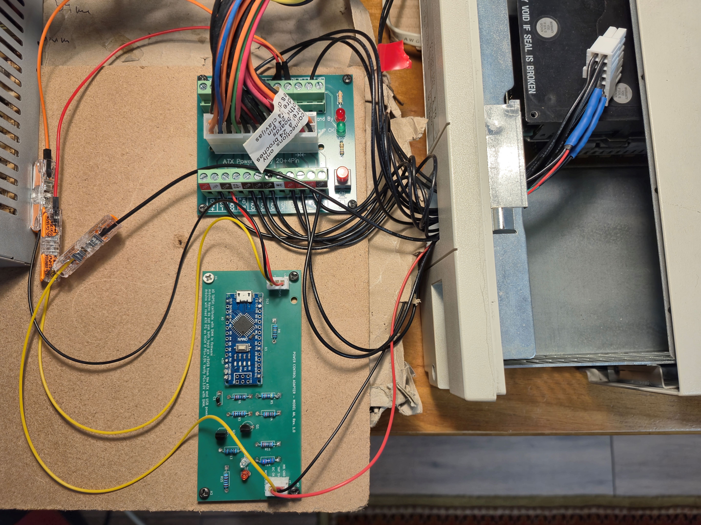

# Target

Model AA is primary designed for the DEC Vax station 3100 M38, but can be used for other computers that require a specific power good (DCOK) delay, protection and diagnostic. Diagnostic is via messages on the serial port from the Arduino.

 
The Protective Earth (PE) between the case and the PSU is not available on this photo. More images are available at: <a href="https://github.com/toncho11/retro_psu_adapter/tree/main/Model_AA/images">Images</a>

# Current functionality

The adapter monitor the power good (PG) of the ATX PSU. It also monitors the 5V rail neat the the motherboard connector. This is called 5V TAP. Once both of them have been stable for specific amount of time (1 second for example) the adapter sends a valid DC OK to the VAX. Pull down resistors are incorporated to avoid dangling signals and prevent accendental startup or shutdown. The card has two diagnostic leds - greend and red. TODO

# How to build

* check the [VAX 3100 M38 PSU doc](https://github.com/toncho11/retro_psu_adapter/blob/main/docs/vax_3100_m38/vax_3100_M38_doc.md)
* find a compatible ATX power supply ... Availabe ... TODO
* Print pcb
* Check BOM, order components TODO
* Order [DS1188 ATX splitter](https://www.amazon.com/clp/B01NBU2C64). Other splitters might be cheaper, but this one is the only one that seems to have really tick tracks that can sustain hight current. Ordering to Europe is expensive.
* Solder the electronic components
* Check [warnings section](https://github.com/toncho11/retro_psu_adapter/blob/main/Model_AA/README.md#warnings-and-important-notes-including-hardware-and-personal-safety-and-software) for personal and hardware safety and other important notes!!!
* Compile and install firmware on the Arduino Nano
* Connect the male 14 pin connector to both DS1188 and the ATX adapter. Use pins provided in the doc ... TODO for the DS118 and the PCB labels. 
* Tap into the 5V near the motherboard's connector and the GND - these are inputs for the PCB
* Calibrate the TAP 5V - ... TODO
* Test before connecting to a motherboard

# Warnings and important notes (including hardware and personal **safety** and software)

* WARNING: External ATX PSU may leave chassis (you computer's case) unearthed! You are probably using an external ATX PSU that it is not touching the computer's case. An internal PSU is grounded and it touches the case. This grounds the case as well. An external PSU changes that. The case might still be grounded through the motherboard's several ground lines, but a proper Protective Earth (PE) line is still needed between the case and the ATX PSU!
* WARNING: A short circuit on the 5V TAP line and a ground can be very dangerous. The holes on the adapter for these lines are very close. You might either solder them together by error or simply touch them using loose wires. Your ATX protection will probably not trigger because it will be within the limits of the PSU power supply's overcurrent protection. The PSU will think you are simply consuming a lot of power. But cables will start melting, exposing these cables to touch other surfaces and creating even bigger problem after a few seconds.
* WARNING: External PSU may compromise internal computer cooling! In Vax 3100 M38 the fans of the PSU are responsible for cooling both the PSU and motherboard, HDDs, etc. Removing the old internal PSU removes this cooling mechanism. Not having an internal PSU means less heat is produced inside the case, but (some) cooling of the motherboard is still needed.
* WARNING: Arduino Nano can be powered on input pin +5VSB through the ATX PSU or through its USB port. Make sure you are not using both. This means that you might want to wait before soldering permanently the +5VSB line from the ATX to the Model AA adapter.
* WARNING: The Arduino firmware uses ATmega328P-specific low-level registers and interrupts (PINB, PORTB, PCINT0_vect) in order to provide a very fast cutt off in case of a problem. It may not work on other Arduino variants without modification. Verify compatibility and DCOK behavior before real use.
* VERIFY: The Arduino will read ATX's POWER GOOD (PG) as HIGH if PG > 3.0V. Verify that your PG > 3.0V.

